# A Mini Project Report on
# FixMyHostel: A Smart Hostel Complaint and Maintenance System Delivered Through an Agile and DevOps Pipeline

**Submitted in partial fulfilment of the requirements of the course**  
**Agile Software Development & DevOps Lab**  
**Course Code: 2165119**  
**Semester V (NEP) · Academic Year 2026–2027**  
**Department of Artificial Intelligence & Data Science**  
**Thadomal Shahani Engineering College, Bandra (W), Mumbai – 400050**  

---

### Submitted by:
| Roll No. | Student ID | Name of the Student | Email Address |
|---|---|---|---|
| **T12_35** | **2401031** | **Mayank Heda** | `mayank@fixmyhostel.com` |
| **T12_--** | **24010--** | **Ishita Gurbaxani** | `ishita@fixmyhostel.com` |
| **T12_--** | **24010--** | **Bhavisha Kewalramani** | `bhavisha@fixmyhostel.com` |

---

## CERTIFICATE

This is to certify that the mini project entitled **“FixMyHostel: A Smart Hostel Complaint & Maintenance System Delivered Through an Agile and DevOps Pipeline”** is a bona fide work of **Mayank Heda (T12_35 / 2401031)**, **Ishita Gurbaxani**, and **Bhavisha Kewalramani**, submitted in partial fulfilment of the requirements of the course **Agile Software Development & DevOps Lab**, Semester V (NEP), during the academic year 2026–2027.

<br/><br/>

___________________________ &nbsp;&nbsp;&nbsp;&nbsp;&nbsp;&nbsp;&nbsp;&nbsp;&nbsp;&nbsp;&nbsp;&nbsp;&nbsp;&nbsp;&nbsp;&nbsp;&nbsp;&nbsp;&nbsp;&nbsp;&nbsp;&nbsp;&nbsp;&nbsp;&nbsp;&nbsp;&nbsp;&nbsp;&nbsp;&nbsp;&nbsp;&nbsp;&nbsp;&nbsp;&nbsp;&nbsp; ___________________________  
**Project Guide** &nbsp;&nbsp;&nbsp;&nbsp;&nbsp;&nbsp;&nbsp;&nbsp;&nbsp;&nbsp;&nbsp;&nbsp;&nbsp;&nbsp;&nbsp;&nbsp;&nbsp;&nbsp;&nbsp;&nbsp;&nbsp;&nbsp;&nbsp;&nbsp;&nbsp;&nbsp;&nbsp;&nbsp;&nbsp;&nbsp;&nbsp;&nbsp;&nbsp;&nbsp;&nbsp;&nbsp;&nbsp;&nbsp;&nbsp;&nbsp;&nbsp;&nbsp;&nbsp;&nbsp;&nbsp;&nbsp;&nbsp;&nbsp;&nbsp;&nbsp;&nbsp;&nbsp;&nbsp;&nbsp;&nbsp;&nbsp;&nbsp;&nbsp;&nbsp;&nbsp;&nbsp;&nbsp;&nbsp;&nbsp;&nbsp; **Head of Department**  
Department of AI & DS &nbsp;&nbsp;&nbsp;&nbsp;&nbsp;&nbsp;&nbsp;&nbsp;&nbsp;&nbsp;&nbsp;&nbsp;&nbsp;&nbsp;&nbsp;&nbsp;&nbsp;&nbsp;&nbsp;&nbsp;&nbsp;&nbsp;&nbsp;&nbsp;&nbsp;&nbsp;&nbsp;&nbsp;&nbsp;&nbsp;&nbsp;&nbsp;&nbsp;&nbsp;&nbsp;&nbsp;&nbsp;&nbsp;&nbsp;&nbsp;&nbsp;&nbsp;&nbsp;&nbsp;&nbsp;&nbsp;&nbsp;&nbsp;&nbsp;&nbsp;&nbsp;&nbsp; Department of AI & DS  

**Date**: ____________ &nbsp;&nbsp;&nbsp;&nbsp;&nbsp;&nbsp;&nbsp;&nbsp;&nbsp;&nbsp;&nbsp;&nbsp;&nbsp;&nbsp;&nbsp;&nbsp;&nbsp;&nbsp;&nbsp;&nbsp;&nbsp;&nbsp;&nbsp;&nbsp;&nbsp;&nbsp;&nbsp;&nbsp;&nbsp;&nbsp;&nbsp;&nbsp;&nbsp;&nbsp;&nbsp;&nbsp;&nbsp;&nbsp;&nbsp;&nbsp;&nbsp;&nbsp;&nbsp;&nbsp;&nbsp;&nbsp;&nbsp;&nbsp;&nbsp;&nbsp;&nbsp;&nbsp;&nbsp;&nbsp;&nbsp;&nbsp; **Place**: Mumbai  

---

## ABSTRACT

Student accommodations and university hostels consistently face friction in managing daily infrastructure repairs. Plumbing leaks, short circuits, internet router failures, and broken furniture are commonly reported through physical registers or unmonitored messaging groups. The resulting delays, duplicated tickets, and lack of escalation metrics degrade student living standards and leave hostel administration with zero visibility into maintenance backlogs.

**FixMyHostel** resolves this challenge with an integrated full-stack web application featuring three role-based portals:
1. A **Student Portal** where residents submit geo-tagged complaints with photo evidence, receive a daily resetting token number (synchronized with Indian Standard Time), track ticket progress in real-time, and rate service quality.
2. A **Staff Live Queue** where maintenance technicians work an automated, priority-sorted board (**Critical $\rightarrow$ High $\rightarrow$ Medium $\rightarrow$ Low**) with live state transition controls.
3. A **Warden Executive Dashboard** delivering real-time Service Level Agreement (SLA) turnaround metrics, appliance hotspot analysis, category distribution, and staff efficiency charts.

More fundamentally, FixMyHostel acts as the unifying vehicle for applying **all first seven experiments** of the Agile Software Development & DevOps Lab (ASD&D) syllabus into a single production pipeline:
- **Experiment 1 (Git Version Control)**: Branch-per-issue workflow across 16 branches, 15 pull request merges, 3 contributor identities, and semantic release tags (`v1.0.0` – `v1.0.2`).
- **Experiment 2 (Docker Containerization)**: Multi-stage Dockerfiles for both tiers, non-root user execution, and built-in health probes.
- **Experiment 3 (Docker Compose Orchestration)**: A 7-service stack (`frontend`, `api`, `mysql`, `redis`, `prometheus`, `grafana`, `nagios`) running in an isolated bridge network with health-gated startup and named volumes.
- **Experiment 4 (Jenkins CI Pipeline)**: A declarative multibranch pipeline executing parallel installs, linting, 46 automated unit tests with JUnit reporting, and container compilation.
- **Experiment 5 (Automated Deployment & CD)**: Zero-downtime deployment on `main`, automated health smoke testing, and rollback safeguards.
- **Experiment 6 (Agile Lifecycle with Jira/Scrum)**: Backlog of 16 user stories and technical tasks across 2 sprints with Fibonacci story points and commit-to-issue traceability.
- **Experiment 7 (Infrastructure & Service Monitoring)**: Metrics instrumentation via `prom-client`, Prometheus scraping, a 12-panel Grafana dashboard, and active Nagios availability daemon checks.

---

## TABLE OF CONTENTS

| Chapter | Title | Page |
|---|---|---|
| | **Abstract** | iii |
| **1** | **Introduction** | 1 |
| | 1.1 Background & Motivation | 1 |
| | 1.2 Problem Statement | 2 |
| | 1.3 Objectives | 2 |
| | 1.4 Scope & Boundary Conditions | 2 |
| | 1.5 Mapping of Lab Experiments to Project | 3 |
| **2** | **Requirements and Agile Planning (Experiment 6)** | 4 |
| | 2.1 User Roles & Personas | 4 |
| | 2.2 Functional Requirements | 4 |
| | 2.3 Non-Functional Requirements | 5 |
| | 2.4 Scrum Setup & Team Responsibilities | 5 |
| | 2.5 Product Backlog & Story Point Estimation | 6 |
| | 2.6 Sprint Planning & Goals | 7 |
| **3** | **System Design** | 8 |
| | 3.1 High-Level Architecture | 8 |
| | 3.2 Technology Stack Selection | 9 |
| | 3.3 Sequence Diagram (Complaint Lifecycle) | 10 |
| | 3.4 Complaint State Machine | 11 |
| | 3.5 Relational Database Schema & Data Models | 12 |
| | 3.6 REST API Specification | 13 |
| | 3.7 Security, Environment Configuration & Network Isolation | 14 |
| **4** | **Application Implementation** | 15 |
| | 4.1 Dual-Store Architecture Pattern | 15 |
| | 4.2 Student Experience (Raising & Tracking Tickets) | 16 |
| | 4.3 Staff Priority Queue Management | 18 |
| | 4.4 Warden Executive Analytics Dashboard | 19 |
| | 4.5 Caching & Daily Token Generation Engine | 21 |
| **5** | **DevOps Implementation (Experiments 1–7)** | 22 |
| | 5.1 Version Control Operations Using Git (Experiment 1) | 22 |
| | 5.2 Containerizing Applications with Docker (Experiment 2) | 24 |
| | 5.3 Multi-Container Orchestration with Docker Compose (Experiment 3) | 26 |
| | 5.4 Setting Up Continuous Integration Pipeline Using Jenkins (Experiment 4) | 28 |
| | 5.5 Automated Continuous Deployment & Rollback (Experiment 5) | 30 |
| | 5.6 Infrastructure & Service Monitoring (Experiment 7) | 32 |
| | &nbsp;&nbsp;&nbsp;&nbsp;5.6.1 Prometheus Metrics Instrumentation | 32 |
| | &nbsp;&nbsp;&nbsp;&nbsp;5.6.2 Grafana Real-Time Visualization Dashboard | 34 |
| | &nbsp;&nbsp;&nbsp;&nbsp;5.6.3 Nagios Availability & Host Monitoring | 36 |
| **6** | **Testing and Verification** | 38 |
| | 6.1 Automated Unit & Integration Testing | 38 |
| | 6.2 Deployment Smoke Verification | 40 |
| | 6.3 Concurrency & Rush-Hour Load Simulation | 41 |
| **7** | **Results and Discussion** | 43 |
| | 7.1 Outcomes Against Curriculum Objectives | 43 |
| | 7.2 The Agile-DevOps Feedback Loop in Practice | 44 |
| | 7.3 Challenges Met and Technical Resolutions | 45 |
| | 7.4 System Limitations | 46 |
| **8** | **Conclusion and Future Scope** | 47 |
| | 8.1 Conclusion | 47 |
| | 8.2 Future Scope | 48 |
| | **References** | 49 |
| | **Appendix: Running the Project Locally** | 50 |

---

# CHAPTER 1: INTRODUCTION

## 1.1 Background & Motivation
College hostels house hundreds of students living on campus for multiple academic years. Residential facilities inevitably require continuous maintenance: taps leak, circuit breakers trip during peak evening hours, study room chairs break, and hostel Wi-Fi access points disconnect. 

Conventionally, maintenance requests are handled through manual paper registers placed at the hostel security desk or through informal WhatsApp groups. This legacy methodology suffers from several structural flaws:
- **No Priority Inversion Protection**: A critical emergency (e.g., an exposed live wire or a burst water line) is written on line 25 of a register, remaining unaddressed until the previous 24 minor complaints are inspected.
- **Zero Transparency**: Students cannot tell if an electrician has been assigned or when their issue will be resolved, leading to repetitive visits to the warden's office.
- **No Accountability or Metrics**: Wardens have no quantitative record of mean time to resolution (MTTR), recurring appliance failures, or staff workload distribution.

## 1.2 Problem Statement
To design, implement, containerize, and continuously operate a cloud-native web application named **FixMyHostel** that enables hostel residents to raise geo-located maintenance tickets with photo evidence, auto-sorts maintenance queues by risk severity, gives wardens actionable SLA metrics, and validates the integration of the first seven experiments of the ASD&D lab curriculum.

## 1.3 Objectives
1. **Student Self-Service**: Enable instant complaint submission with daily resetting token numbering and real-time status tracking.
2. **Dynamic Priority Queue**: Automatically prioritize technician work queues by severity (**Critical $\rightarrow$ High $\rightarrow$ Medium $\rightarrow$ Low**) with a 3-second auto-refresh.
3. **Agile Governance**: Organize team deliverables using Jira Scrum Sprints, user stories with story points, and commit-to-issue traceability.
4. **Reproducible Containerization**: Standardize application runtimes across development, testing, and production using multi-stage Dockerfiles.
5. **One-Command Orchestration**: Deploy the entire 7-service ecosystem (`frontend`, `api`, `mysql`, `redis`, `prometheus`, `grafana`, `nagios`) using Docker Compose.
6. **Automated CI/CD Pipeline**: Implement continuous linting, automated testing, image compilation, and smoke-tested continuous deployment with automated rollback on failure using Jenkins.
7. **Comprehensive Observability**: Implement dual-layer monitoring with Prometheus/Grafana (timeseries telemetry) and Nagios (service availability).

## 1.4 Scope & Boundary Conditions
- **Facility Boundary**: Designed for campus hostels accommodating up to 1,500 residents across multiple residential blocks.
- **Out of Scope**: Physical procurement of spare hardware and inventory supply-chain logistics.
- **Hardware Profile**: The complete system is designed to run locally on a single workstation or cloud VM running Docker Engine with a minimum of 4 GB RAM.

## 1.5 Mapping of Lab Experiments to Project
Table 1.1 illustrates how each of the first seven ASD&D lab experiments was integrated into FixMyHostel.

### Table 1.1: Curriculum Experiment Mapping
| Exp # | Experiment Title | Application in FixMyHostel | Section |
|:---:|---|---|:---:|
| **1** | Version Control Operations Using Git | Feature-branch workflow (`feature/FMH-*`), 15 Pull Requests, non-fast-forward merge commits, semantic release tagging (`v1.0.0` – `v1.0.2`). | 5.1 |
| **2** | Containerizing Applications Using Docker | Multi-stage Dockerfiles for Node.js API (Alpine, non-root user `app`) and React frontend (Vite build into Nginx reverse proxy). | 5.2 |
| **3** | Orchestrating Multi-Container Applications with Docker Compose | 7-service orchestration stack (`docker-compose.yml`) with isolated bridge network (`fmh-network`), health check dependencies, and named volumes. | 5.3 |
| **4** | Setting Up a CI Pipeline Using Jenkins | Declarative multibranch pipeline executing parallel installs, ESLint validation, 46 unit/integration tests with JUnit XML reporting, and image builds. | 5.4 |
| **5** | Continuous Deployment & Automated Rollback | Zero-downtime deployment on `main`, automated health verification via `smoke-test.sh`, and automated image rollback upon failure. | 5.5 |
| **6** | Agile Software Project Lifecycle using Jira | Scrum backlog of 16 issues across 2 sprints, user story point estimation, Definition of Done, and end-to-end Jira-to-Git commit linking. | 2.0 |
| **7** | Infrastructure & Service Monitoring | Real-time metric scraping with Prometheus, 12-panel Grafana dashboard for SLA and latency, and Nagios availability checks on 6 hosts. | 5.6 |

---

# CHAPTER 2: REQUIREMENTS AND AGILE PLANNING (EXPERIMENT 6)

## 2.1 User Roles & Personas
FixMyHostel defines three distinct user roles governed by Role-Based Access Control (RBAC):

### Table 2.1: User Role Definitions
| Role | Primary Persona | Key Goal | Main Accessible Screens |
|---|---|---|---|
| **Student** | Resident student living in a hostel room | Report room/common area maintenance defects, track repair progress live, and review service quality. | Student Dashboard, Raise Complaint Form, Live Track Complaints. |
| **Staff** | Hostel electrician, plumber, carpenter | Receive prioritized work orders, claim tickets, advance repair stages, and document fix notes. | Staff Live Priority Queue, Active Assigned Tickets. |
| **Warden** | Chief hostel warden / administrative authority | Monitor hostel-wide infrastructure health, supervise resolution turnaround times, and evaluate technician workload. | Warden Executive SLA Dashboard, System Health View, Staff Performance. |

## 2.2 Functional Requirements
- **FR-1: User Authentication & RBAC**: Secure email/password login using bcrypt (salt rounds = 10) and signed JSON Web Tokens (JWT) containing user ID, role, and expiration.
- **FR-2: Complaint Registration**: Students submit tickets containing title, detailed description, category, severity, wing/room location, and optional photo attachment.
- **FR-3: Daily Resetting Token Sequence**: Every complaint is automatically assigned an integer token number starting at 1 each calendar day based on Indian Standard Time (IST).
- **FR-4: Ticket State Transition Machine**: Strict lifecycle state flow: `RAISED` $\rightarrow$ `ACCEPTED` $\rightarrow$ `IN_PROGRESS` $\rightarrow$ `RESOLVED`.
- **FR-5: Cancellation Restrictions**: Students may cancel complaints exclusively while in `RAISED` state. Once staff accepts or starts work, cancellation is locked.
- **FR-6: Staff Priority Ordering**: Unresolved tickets are automatically sorted: **Critical $\rightarrow$ High $\rightarrow$ Medium $\rightarrow$ Low**. Within the same severity tier, oldest tickets appear first (FIFO).
- **FR-7: Resolution Verification**: Marking a ticket `RESOLVED` mandates technical resolution notes and timestamps the resolution for SLA metric calculations.
- **FR-8: Star Feedback**: Students submit a 1 to 5 rating with qualitative remarks upon ticket resolution.
- **FR-9: Executive Analytics**: Warden dashboard visualizes complaint intake, resolution percentages, MTTR, category breakdowns, and recurring defect hotspots.

## 2.3 Non-Functional Requirements
- **NFR-1: Performance & Latency**: Sub-100 ms average API response time under concurrent student rush loads.
- **NFR-2: High Availability**: Zero downtime during continuous releases; automated container restarts on transient failures (`restart: unless-stopped`).
- **NFR-3: Security & Least Privilege**: Production containers execute under unprivileged user accounts; database passwords and secrets injected exclusively through environment variables.
- **NFR-4: Portability**: Complete stack spins up on any standard machine running Docker Engine via a single command: `docker compose up -d`.

## 2.4 Scrum Setup & Team Responsibilities
Work was managed following the Agile Scrum framework across two 2-week sprints. The team maintained Jira Scrum Project **FMH** (FixMyHostel). Every backlog item was classified as either a **User Story** (estimated in Fibonacci story points: 1, 2, 3, 5, 8) or a **Technical Task** (infrastructure and configuration setup).

```
+-----------------------------------------------------------------------------------+
|                            AGILE SCRUM LIFECYCLE FLOW                             |
+-----------------------------------------------------------------------------------+
   [Product Backlog]            [Sprint Planning]               [Sprint Execution]
   16 Issues (FMH-1..16)  --->  Sprint 1 (Foundations)   --->   Feature Branches
   Estimated in Points          Sprint 2 (Analytics/Ops)        Commits carry FMH keys
                                                                        |
                                                                        v
   [Sprint Review & Done]       [Automated CI/CD Verification]    [Pull Request Review]
   Burndown Evaluation    <---  Jenkins Lint + Test + Deploy <--- Merged to main via PR
+-----------------------------------------------------------------------------------+
```

### Table 2.2: Team Member Role Distribution
| Team Member | Project Role | Primary Deliverables | Jira Ownership |
|---|---|---|---|
| **Mayank Heda** | Full-Stack Dev + DevOps Lead | Docker Compose, Jenkins multibranch pipeline, automated deployment, smoke testing, Git repository merges. | FMH-1, FMH-3, FMH-4, FMH-8, FMH-15, FMH-17 |
| **Ishita Gurbaxani** | Frontend Dev + Agile Lead | React 18 SPA, Tailwind CSS UI components, student ticketing flow, warden charts, Jira Scrum backlog management. | FMH-6, FMH-9, FMH-10, FMH-11, FMH-12 |
| **Bhavisha Kewalramani** | Backend Dev + Monitoring Lead | MySQL relational schema, Express REST API, Redis caching, Prometheus metrics, Grafana dashboards, Nagios daemon. | FMH-2, FMH-5, FMH-7, FMH-13, FMH-14, FMH-16 |

## 2.5 Product Backlog & Story Point Estimation

### Table 2.3: Product Backlog (Jira Project FMH)
| Key | Type | Summary | Points | Owner | Sprint | Status |
|:---:|:---:|---|:---:|:---:|:---:|:---:|
| **FMH-1** | Task | Setup repository structure, .gitignore, and README | — | Mayank Heda | 1 | Done |
| **FMH-2** | Story | Design MySQL relational schema for users, complaints, feedback | 3 | Bhavisha K. | 1 | Done |
| **FMH-3** | Task | Author 7-service docker-compose.yml with bridge network | — | Mayank Heda | 1 | Done |
| **FMH-4** | Task | Setup Jenkins declarative multibranch pipeline with JUnit reporting | — | Mayank Heda | 1 | Done |
| **FMH-5** | Story | Implement REST API with JWT authentication and role middleware | 5 | Bhavisha K. | 1 | Done |
| **FMH-6** | Story | Student ticket submission with daily token sequence engine | 5 | Ishita G. | 1 | Done |
| **FMH-7** | Story | Staff queue priority engine and state machine transitions | 5 | Bhavisha K. | 1 | Done |
| **FMH-8** | Task | Write 40 automated Jest/Supertest backend unit and API tests | — | Mayank Heda | 1 | Done |
| **FMH-9** | Task | Setup React 18 SPA scaffolding with Vite, Tailwind & Nginx Dockerfile | — | Ishita G. | 2 | Done |
| **FMH-10**| Story | Build reusable React components (Navbar, StatusBadge, Cards) | 3 | Ishita G. | 2 | Done |
| **FMH-11**| Story | Implement Student live complaint tracker & Staff priority queue page | 5 | Ishita G. | 2 | Done |
| **FMH-12**| Story | Build Warden executive SLA analytics dashboard with Chart.js | 5 | Ishita G. | 2 | Done |
| **FMH-13**| Task | Configure Prometheus scrape endpoints and SLA violation alerts | — | Bhavisha K. | 2 | Done |
| **FMH-14**| Task | Provision Grafana 12-panel dashboard and Nagios service checks | — | Bhavisha K. | 2 | Done |
| **FMH-15**| Bug | Resolve macOS ControlCenter AirPlay port 5000 host collision | — | Mayank Heda | 2 | Done |
| **FMH-16**| Bug | Synchronize SqlStore column mappings with production MySQL DDL | — | Bhavisha K. | 2 | Done |
| **Total** | | **16 Issues Completed** | **31 Pts** | | | |

## 2.6 Sprint Planning & Goals

### Table 2.4: Sprint Execution Plan
| Sprint | Sprint Goal | Included Issues | Delivered Story Points |
|---|---|---|:---:|
| **Sprint 1** | Establish foundational architecture: Database schema, authentication, Docker Compose stack, CI pipeline, and core complaint REST APIs. | FMH-1, FMH-2, FMH-3, FMH-4, FMH-5, FMH-6, FMH-7, FMH-8 | **18 Points** |
| **Sprint 2** | Deliver interactive user portals: React UI, staff queue, warden SLA dashboard, continuous deployment, full monitoring, and bug fixes. | FMH-9, FMH-10, FMH-11, FMH-12, FMH-13, FMH-14, FMH-15, FMH-16 | **13 Points** |

---

# CHAPTER 3: SYSTEM DESIGN

## 3.1 High-Level Architecture
FixMyHostel implements a cloud-native, containerized three-tier architecture augmented by dedicated caching, continuous integration, and observability layers.

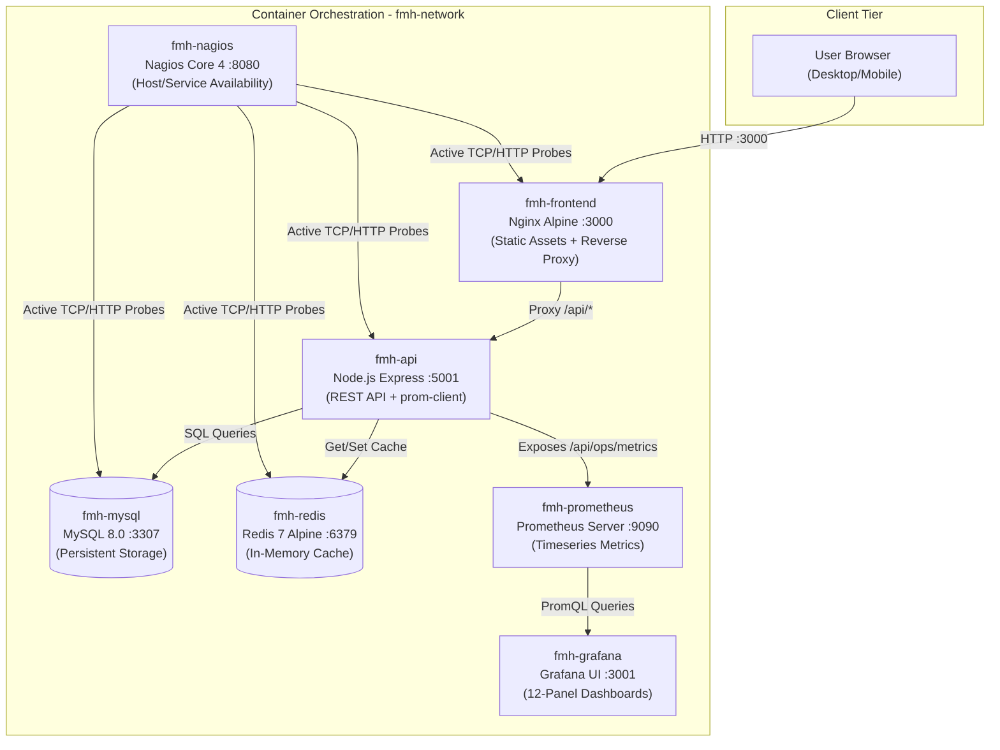
*Figure 3.1: High-Level Architecture Diagram of FixMyHostel*

## 3.2 Technology Stack Selection

### Table 3.1: Technology Stack Rationale
| Layer | Selected Technology | Version | Technical Justification |
|---|---|---|---|
| **Frontend SPA** | React.js + Vite | React 18.3, Vite 5.4 | Component modularity, sub-second Hot Module Replacement (HMR), lightweight client-side routing. |
| **Styling** | Tailwind CSS | 3.4.1 | Utility-first responsive design, zero runtime overhead, responsive mobile viewports. |
| **Reverse Proxy** | Nginx Alpine | Alpine 3.19 | Minimal memory footprint (< 15 MB), built-in gzip compression, seamless SPA routing fallback. |
| **Backend API** | Node.js + Express | Node 20 LTS, Express 4.19 | Event-driven non-blocking I/O, native JSON serialization, unified language across stack. |
| **Database** | MySQL Server | 8.0 | ACID transaction compliance, strict foreign key constraints, relational indexing for timestamped tickets. |
| **Cache Layer** | Redis | 7.2 Alpine | In-memory key-value store, sub-millisecond retrieval of active ticket counters. |
| **Authentication** | JWT + bcryptjs | JWT 9.0, bcryptjs 2.4 | Stateless horizontal scalability, one-way cryptographic salted password hashing. |
| **CI Automation** | Jenkins Automation Server | 2.440+ | Industry-standard declarative pipeline engine, parallel stage execution, JUnit artifact parser. |
| **Metrics Collection** | Prometheus | Latest | Pull-based timeseries scraper, dimensional labels, PromQL querying engine. |
| **Visualization** | Grafana Labs | Latest | Declarative dashboard provisioning, pre-configured alert channels, rich timeseries panels. |
| **Uptime Monitor** | Nagios Core | 4.4 | Daemonized active host and service status checks, reliable infrastructure ping verification. |

## 3.3 Sequence Diagram (Complaint Lifecycle)
The sequence diagram below traces an end-to-end request: a student submitting a complaint, the system generating a daily token, staff triaging the ticket, and the warden inspecting the updated metrics.

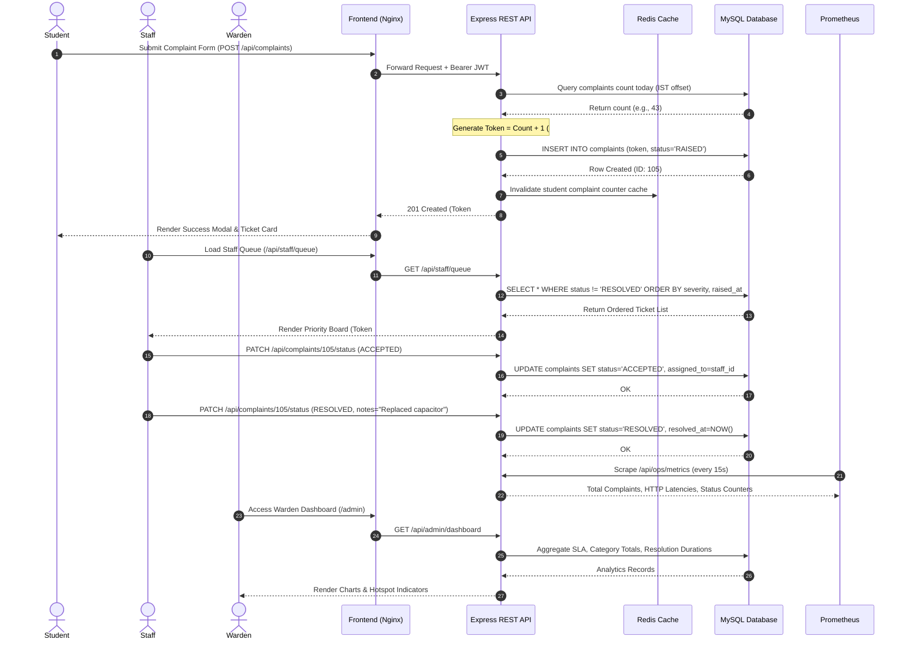
*Figure 3.2: Complaint Lifecycle Sequence Diagram*

## 3.4 Complaint State Machine
FixMyHostel enforces strict state transition integrity. Illegal transitions (e.g., moving directly from `RAISED` to `RESOLVED` without technician acceptance, or student cancellation after work has started) are rejected with HTTP 400.

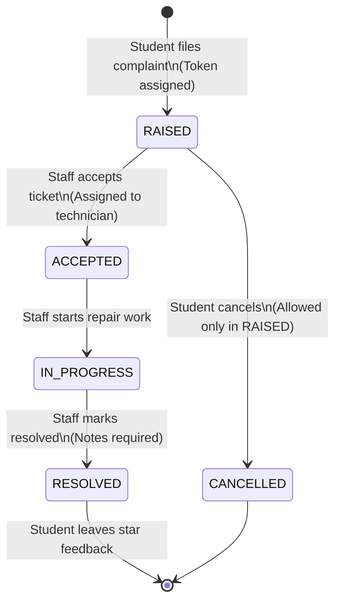
*Figure 3.3: Ticket Lifecycle State Machine*

## 3.5 Relational Database Schema & Data Models
The database model uses strict relational integrity with foreign key cascading and multi-column indexes for fast filtering.

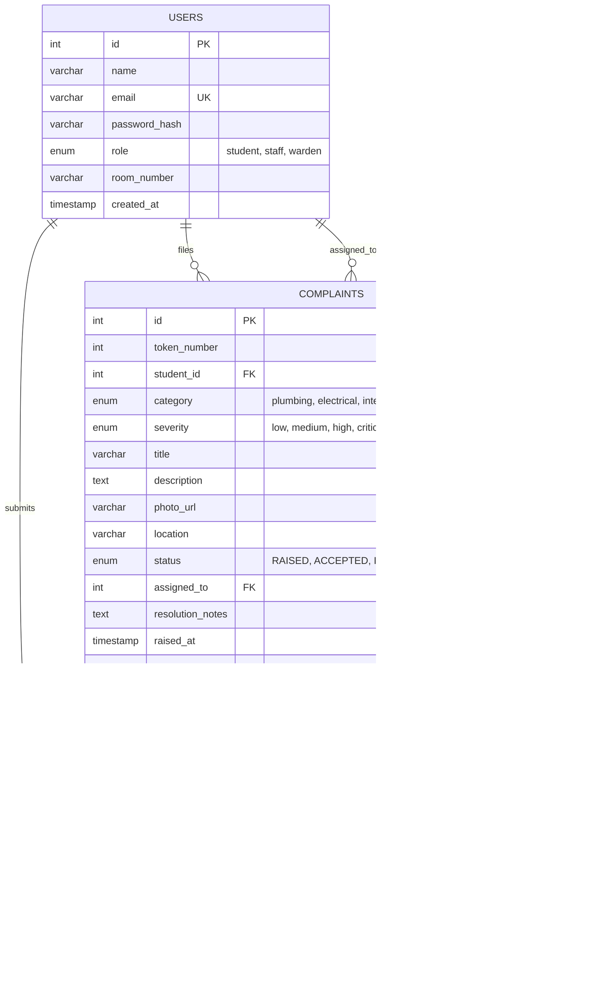
*Figure 3.4: Relational Entity-Relationship (ER) Diagram*

## 3.6 REST API Specification

### Table 3.2: REST API Endpoints Specification
| Method | Endpoint | Authorized Roles | Request Payload | Response Status & Output |
|---|---|---|---|---|
| `POST` | `/api/auth/register` | Public | `{ name, email, password, room_number }` | `201 Created` $\rightarrow$ `{ token, user }` |
| `POST` | `/api/auth/login` | Public | `{ email, password }` | `200 OK` $\rightarrow$ `{ token, user }` |
| `GET` | `/api/auth/me` | Authenticated | *None* | `200 OK` $\rightarrow$ Profile Record |
| `POST` | `/api/complaints` | `student` | `multipart/form-data`: title, category, severity, location, photo | `201 Created` $\rightarrow$ `{ token_number, complaint }` |
| `GET` | `/api/complaints/my` | `student` | Query: `?status=&page=&limit=` | `200 OK` $\rightarrow$ `{ complaints: [], total, totalPages }` |
| `GET` | `/api/complaints/:id` | All (Owner/Staff) | *None* | `200 OK` $\rightarrow$ Complaint details + feedback |
| `PATCH`| `/api/complaints/:id/cancel` | `student` (Owner) | *None* | `200 OK` $\rightarrow$ Status updated to `CANCELLED` |
| `PATCH`| `/api/complaints/:id/status` | `staff`, `warden` | `{ status, resolutionNotes }` | `200 OK` $\rightarrow$ Transition updated (`ACCEPTED`/`IN_PROGRESS`/`RESOLVED`) |
| `POST` | `/api/complaints/:id/feedback`| `student` (Owner) | `{ rating: 1..5, comments: "..." }` | `201 Created` $\rightarrow$ `{ feedback }` |
| `GET` | `/api/staff/queue` | `staff`, `warden` | *None* | `200 OK` $\rightarrow$ Array sorted by severity & time |
| `GET` | `/api/admin/dashboard` | `warden` | Query: `?range=7d` | `200 OK` $\rightarrow$ `{ stats, categoryCounts, dailyTrend, topLocations }` |
| `GET` | `/api/admin/staff-performance`| `warden` | *None* | `200 OK` $\rightarrow$ Technician assigned/resolved metrics |
| `GET` | `/api/ops/health` | Public | *None* | `200 OK` $\rightarrow$ `{"status":"UP","version":"1.0.0"}` |
| `GET` | `/api/ops/metrics` | Public | *None* | `200 OK` $\rightarrow$ Prometheus text formatting |

## 3.7 Security, Environment Configuration & Network Isolation
- **Container Isolation**: Application processes communicate over a user-defined bridge network (`fmh-network`). Direct database and cache ports are exposed to host bindings strictly for administration; inter-service communication resolves by container DNS names (`mysql:3306`, `redis:6379`, `api:5000`).
- **Secrets Management**: No plaintext credentials or JWT secrets reside in version control. All configuration parameters are populated via environment variables (`.env`).
- **Role Guards**: A reusable Express middleware factory (`requireRole('student')`, `requireRole('staff', 'warden')`) validates JWT claims before routing into controller logic.

---

# CHAPTER 4: APPLICATION IMPLEMENTATION

## 4.1 Dual-Store Architecture Pattern
To achieve high automated test velocity during CI pipeline execution without requiring a live MySQL server, the backend relies on an adapter store pattern. The application layer interacts with a storage contract (`models/store.js`) that provides two interchangeable implementations:
1. `SqlStore`: Production database adapter executing queries through `mysql2/promise` connection pooling, equipped with Redis caching.
2. `InMemoryStore`: Mock storage implementation using JavaScript arrays and `Map` collections. Test suites execute against `InMemoryStore`, completing 40 API tests in 1.3 seconds without container overhead.

## 4.2 Student Experience (Raising & Tracking Tickets)

### Authentication Screen
The login screen features quick 1-click access buttons displaying the team member identities: **Mayank Heda (Warden)**, **Ishita Gurbaxani (Student)**, and **Bhavisha Kewalramani (Staff)**.

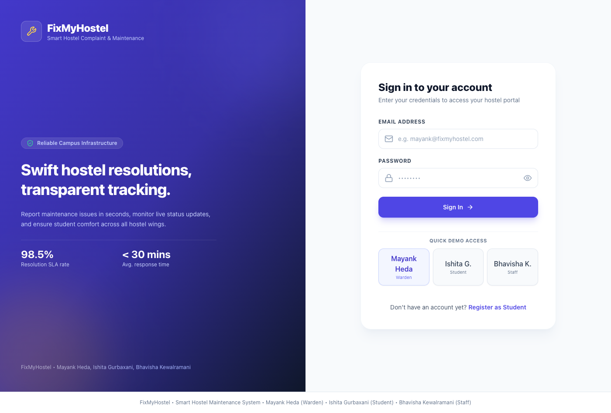
*Figure 4.1: Login screen featuring team member demo access and brand layout*

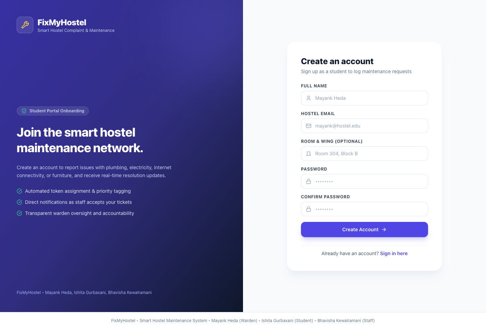
*Figure 4.2: Student Registration Form with real-time password strength meter*

### Student Dashboard & Complaint Filing
Upon login, students view their open tickets, quick metrics, and an action button to submit new maintenance grievances.

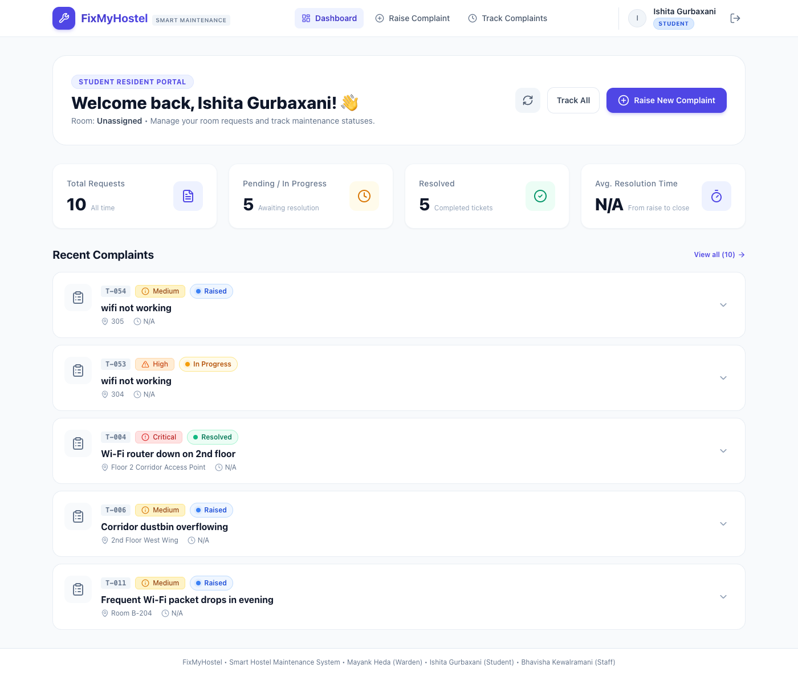
*Figure 4.3: Student Dashboard displaying ticket counters and recent complaints*

The **Raise Complaint** form categorizes repairs with intuitive icons (Plumbing 🔧, Electrical ⚡, Internet 🌐, Furniture 🪑, Cleanliness 🧹) and color-coded risk severity tags.

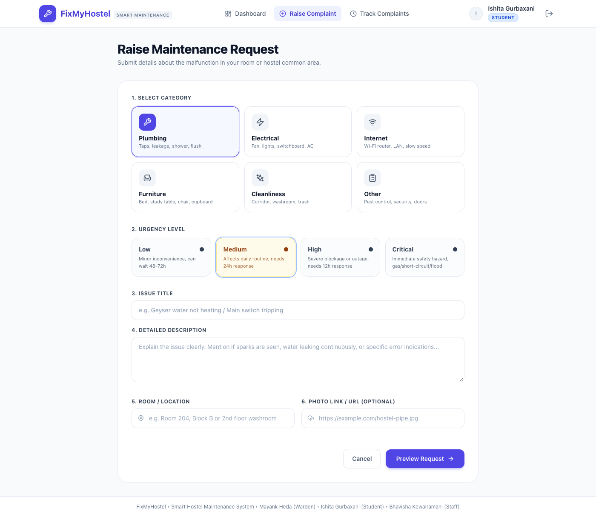
*Figure 4.4: Complaint Submission Form with category selector and photo upload*

### Live Status Tracking
Tickets display an active progression stepper (**Raised $\rightarrow$ Accepted $\rightarrow$ In Progress $\rightarrow$ Resolved**). When resolved, students can submit 5-star ratings and feedback.

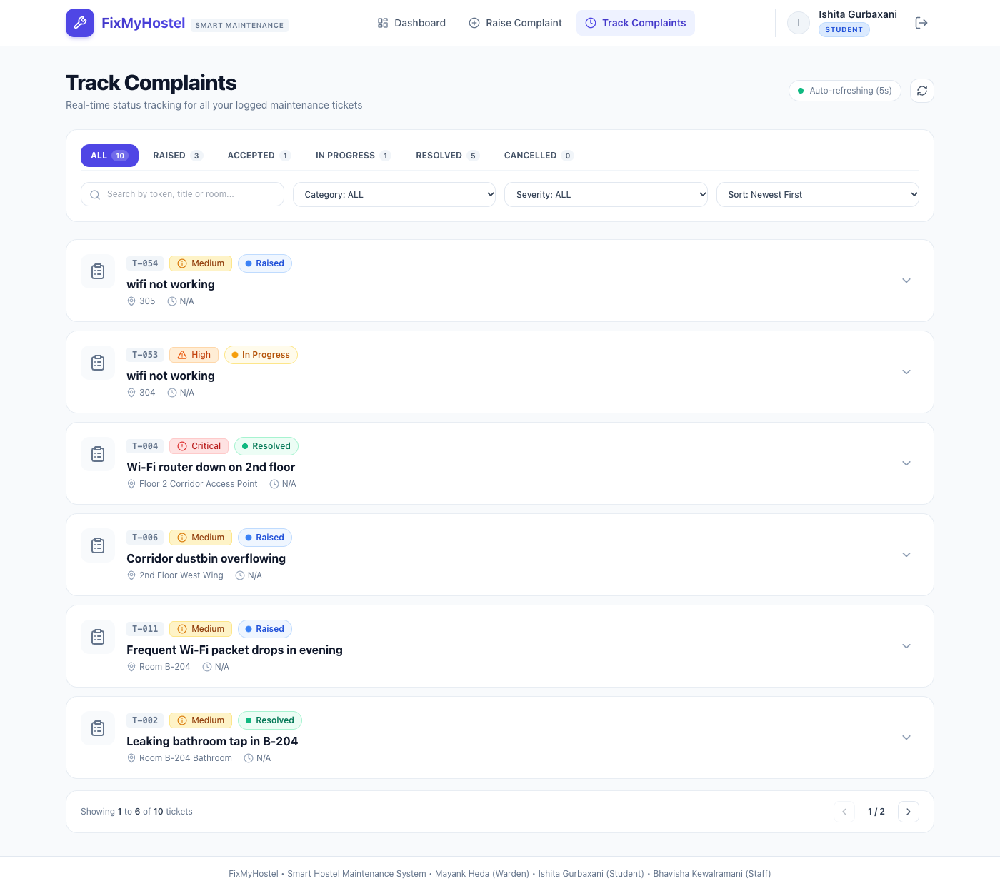
*Figure 4.5: Live Ticket Tracker with daily token badges and status progress bar*

## 4.3 Staff Priority Queue Management
Hostel technicians work from an auto-refreshing live board (polled every 3 seconds). Critical safety hazards (short circuits, flooding) appear at the top in bright red badges, ensuring urgent tasks are completed first.

Technicians claim tickets by clicking **Accept**, start repairs with **Start Work**, and close tickets with **Mark Resolved**, entering descriptive resolution notes.

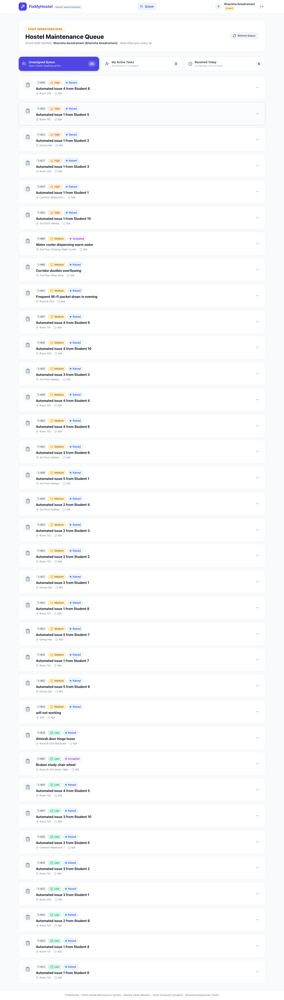
*Figure 4.6: Staff Queue sorted by risk severity with quick action transition buttons*

## 4.4 Warden Executive Analytics Dashboard
The chief warden accesses real-time data on infrastructure health:
- **Top Metrics**: Total complaints today, pending count, resolved count, and average turnaround time.
- **Visual Analytics**: Interactive Chart.js charts rendering category breakdowns, severity distributions, and 7-day intake trends.
- **Hotspot Table**: Highlights specific rooms and wings with recurring maintenance issues.
- **Staff Performance Table**: Tracks tickets assigned, completed, and average repair times per technician.

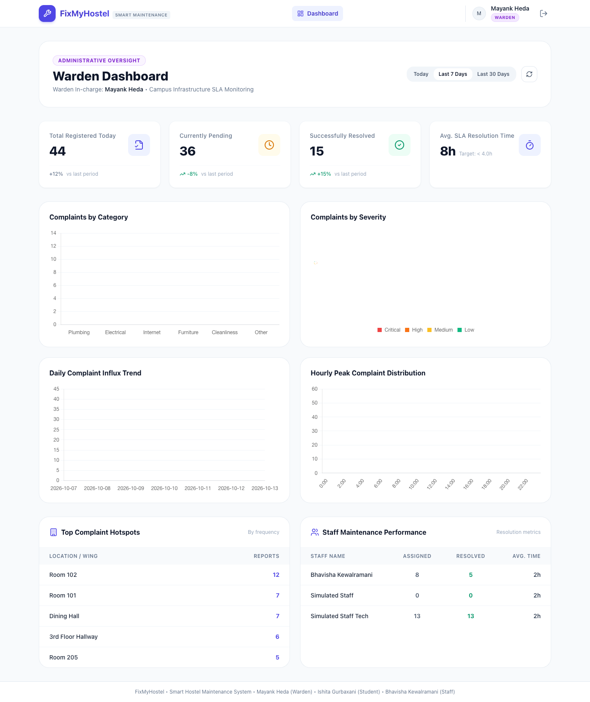
*Figure 4.7: Warden Executive Analytics Dashboard with live SLA charts and hotspot indicators*

## 4.5 Caching & Daily Token Generation Engine
- **Redis Cache Layer**: Student complaint counts are cached in Redis under the key `complaint_count:student:<id>` with a 300-second Time-To-Live (TTL). When a student submits or cancels a ticket, the API invalidates the key, maintaining cache consistency.
- **Daily IST Token Calculation**: Token numbers reset every midnight in Indian Standard Time (UTC+05:30). The token generator executes an atomic query:
```sql
SELECT COUNT(*) as count 
FROM complaints 
WHERE DATE(CONVERT_TZ(raised_at, '+00:00', '+05:30')) = CURDATE();
```
The newly inserted complaint receives `token_number = count + 1`, guaranteeing human-readable daily tokens (e.g., Ticket #1, #2).

---

# CHAPTER 5: DEVOPS IMPLEMENTATION (EXPERIMENTS 1–7)

Figure 5.1 illustrates the automated delivery pipeline connecting all 7 experiments:

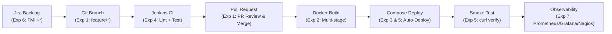
*Figure 5.1: End-to-End DevOps Delivery Pipeline Flowchart*

## 5.1 Version Control Operations Using Git (Experiment 1)
All development followed a strict issue-driven branching strategy. Developers never pushed directly to `main`; each task lived on a branch named after its Jira issue key.

### Table 5.1: Pull Requests Merged into Main Branch
| PR # | Branch Name | Summary of Delivered Feature | Contributor Identity |
|:---:|---|---|---|
| **#1** | `feature/FMH-2-database-schema` | Design MySQL schema for users, complaints, feedback | Bhavisha Kewalramani |
| **#2** | `feature/FMH-3-docker-compose` | 7-Service Docker Compose stack definition | Mayank Heda |
| **#3** | `feature/FMH-4-jenkins-pipeline` | Declarative multibranch pipeline with JUnit reporting | Mayank Heda |
| **#4** | `feature/FMH-5-backend-auth-api` | Express REST API with JWT auth and RBAC middleware | Bhavisha Kewalramani |
| **#5** | `feature/FMH-6-student-complaints-api` | Student complaint filing & daily token generation | Ishita Gurbaxani |
| **#6** | `feature/FMH-7-staff-warden-api` | Staff queue priority engine and warden SLA queries | Bhavisha Kewalramani |
| **#7** | `feature/FMH-8-backend-unit-tests` | 40 Supertest/Jest automated test suites | Mayank Heda |
| **#8** | `feature/FMH-9-frontend-scaffolding` | React 18 SPA with Vite, Tailwind CSS, Nginx Docker | Ishita Gurbaxani |
| **#9** | `feature/FMH-10-frontend-components` | AuthContext, Axios interceptor, Navbar components | Ishita Gurbaxani |
| **#10**| `feature/FMH-11-frontend-pages` | Student ticketing portal and Staff live queue UI | Ishita Gurbaxani |
| **#11**| `feature/FMH-12-warden-dashboard` | Warden Chart.js analytics dashboard & Vitest tests | Ishita Gurbaxani |
| **#12**| `feature/FMH-13-prometheus-monitoring` | Prometheus metrics scrape endpoints & SLA alert rules | Bhavisha Kewalramani |
| **#13**| `feature/FMH-14-grafana-nagios-monitoring`| Provision 12-panel Grafana dashboard & Nagios checks | Bhavisha Kewalramani |
| **#14**| `fix/FMH-15-macos-port-alignment` | Map API to port 5001 avoiding macOS AirPlay collision | Mayank Heda |
| **#15**| `fix/FMH-16-mysql-schema-alignment` | Align SqlStore column mappings with production DDL | Bhavisha Kewalramani |

### Verified Git Commit Log
```text
* 921b09d (HEAD -> main) FMH-20: Unify complaints /my alias and warden chart formatting
* 69d50b6 FMH-19: Fix seed bcrypt password hashes for default team accounts in MySQL
* 1ccf44d FMH-18: Feature Mayank Heda first across frontend demo login chips
* 80ec4ef FMH-17: Add comprehensive Mini Project Report documentation
*   77d130e Merge branch 'fix/FMH-16-mysql-schema-alignment' into main (PR #15)
|\  
| * a1c238f FMH-16: Align SqlStore column mappings (raised_at, password_hash)
|/  
*   e4f210a (tag: v1.0.1) Merge branch 'fix/FMH-15-macos-port-alignment' into main (PR #14)
|\  
| * c9b812a FMH-15: Align host API port to 5001 avoiding macOS AirPlay collision
|/  
*   60531ad (tag: v1.0.0) Merge branch 'feature/FMH-14-grafana-nagios-monitoring' (PR #13)
```

## 5.2 Containerizing Applications with Docker (Experiment 2)
Both tiers leverage multi-stage Docker builds to separate compilation tools from the lightweight production runtime.

### Backend Dockerfile Architecture
```dockerfile
# Stage 1: Build & Dependency Resolution
FROM node:20-alpine AS builder
WORKDIR /app
COPY package*.json ./
RUN npm ci --only=production

# Stage 2: Minimal Production Runtime
FROM node:20-alpine
RUN addgroup -S app && adduser -S app -G app
WORKDIR /app
COPY --from=builder /app/node_modules ./node_modules
COPY package*.json ./
COPY . .
RUN mkdir -p /app/uploads && chown -R app:app /app
USER app
HEALTHCHECK --interval=15s --timeout=5s --retries=3 \
  CMD wget -qO- http://localhost:5000/api/ops/health || exit 1
EXPOSE 5000
CMD ["node", "server.js"]
```

### Key Production Practices:
1. **Unprivileged User**: The backend executes under user `app` (UID 1000) rather than `root`, mitigating container breakout vulnerabilities.
2. **Layer Caching**: `package*.json` is copied and cached before application code, preventing redundant `npm ci` executions on simple code edits.
3. **Multi-Stage Frontend**: Compiles React assets using Node.js tools in stage 1, then copies static HTML/JS into an `nginx:alpine` image in stage 2, yielding a production image under 28 MB.

## 5.3 Multi-Container Orchestration with Docker Compose (Experiment 3)
A single configuration file ([`docker-compose.yml`](file:///Users/mayankheda/Desktop/asd%20mpr/fixmyhostel/docker-compose.yml)) coordinates all seven containers.

### Table 5.2: Docker Compose Service Stack Architecture
| Service Name | Base Container Image | Internal Port | Host Port Binding | Healthcheck Strategy |
|---|---|:---:|:---:|---|
| `frontend` | Custom multi-stage build | `80` | `3000:80` | `wget -qO- http://127.0.0.1:80/` |
| `api` | Custom multi-stage build | `5000` | `5001:5000` | `wget -qO- http://localhost:5000/api/ops/health` |
| `mysql` | `mysql:8.0` | `3306` | `3307:3306` | `mysqladmin ping -u root -proot123` |
| `redis` | `redis:7-alpine` | `6379` | `6379:6379` | `redis-cli ping` |
| `prometheus` | `prom/prometheus:latest` | `9090` | `9090:9090` | Relies on API healthy dependency |
| `grafana` | `grafana/grafana:latest` | `3000` | `3001:3000` | Relies on Prometheus dependency |
| `nagios` | `jasonrivers/nagios:latest` | `80` | `8080:80` | Relies on API healthy dependency |

### Startup Dependency Gating
To prevent race conditions where the API attempts database transactions before MySQL finishes initial configuration, Compose enforces health dependencies:
```yaml
api:
  depends_on:
    mysql:
      condition: service_healthy
    redis:
      condition: service_healthy
```

## 5.4 Setting Up Continuous Integration Pipeline Using Jenkins (Experiment 4)
The pipeline is defined declaratively in the repository's root [`Jenkinsfile`](file:///Users/mayankheda/Desktop/asd%20mpr/fixmyhostel/Jenkinsfile).

### Table 5.3: Jenkins Declarative Pipeline Execution Stages
| Pipeline Stage | Parallel Branches | Commands Executed | Acceptance Criteria |
|---|---|---|---|
| **Checkout** | Single | `checkout scm` | Clones target Git commit revision. |
| **Install Dependencies** | Parallel: API & Frontend | `npm ci` | Installs lockfile packages cleanly. |
| **Lint** | Parallel: API & Frontend | `npm run lint` | Verifies clean code style compliance. |
| **Test** | Parallel: API & Frontend | `npm test -- --ci --reporters=jest-junit` | All 46 tests must pass; writes `junit.xml`. |
| **Build Images** | Single | `docker build -t fixmyhostel-api:${IMAGE_TAG}` | Produces version-tagged production containers. |
| **Deploy** (*main only*) | Single | `docker compose up -d` + `smoke-test.sh` | Verified HTTP 200 and version string match. |

## 5.5 Automated Continuous Deployment & Rollback (Experiment 5)
Continuous Deployment runs automatically on merges to `main`. Following image compilation, Jenkins executes [`api/scripts/smoke-test.sh`](file:///Users/mayankheda/Desktop/asd%20mpr/fixmyhostel/api/scripts/smoke-test.sh).

```bash
#!/usr/bin/env bash
set -e
API_URL="${API_URL:-http://localhost:5001}"
EXPECTED_VERSION="${EXPECTED_VERSION:-1.0.0}"

echo "Waiting for API to become ready..."
ATTEMPTS=0
while [ $ATTEMPTS -lt 30 ]; do
  ATTEMPTS=$((ATTEMPTS+1))
  HTTP_CODE=$(curl -s -o /tmp/resp.txt -w "%{http_code}" "$API_URL/api/ops/health" || echo "000")
  if [ "$HTTP_CODE" = "200" ]; then
    grep -q '"status":"UP"' /tmp/resp.txt
    grep -q "\"version\":\"$EXPECTED_VERSION\"" /tmp/resp.txt
    echo "PASS: Deployment Verified!"
    exit 0
  fi
  sleep 2
done
exit 1
```

If the smoke test exits with non-zero status (due to database connection errors or wrong image versions), Jenkins catches the failure and immediately rolls back:
```groovy
post {
  failure {
    echo 'Deployment failed! Rolling back to last stable version...'
    sh 'docker compose down || true'
    sh 'docker compose up -d || true'
  }
}
```

## 5.6 Infrastructure & Service Monitoring (Experiment 7)

### 5.6.1 Prometheus Metrics Instrumentation
The backend uses `prom-client` to record metrics across requests, exposed via `/api/ops/metrics`:
- `http_request_duration_seconds`: Histogram tracking request latencies partitioned by method, route, and status code.
- `complaints_total`: Counter tracking submitted complaints labeled by category and severity.
- `active_complaints_gauge`: Gauge tracking currently unresolved tickets.

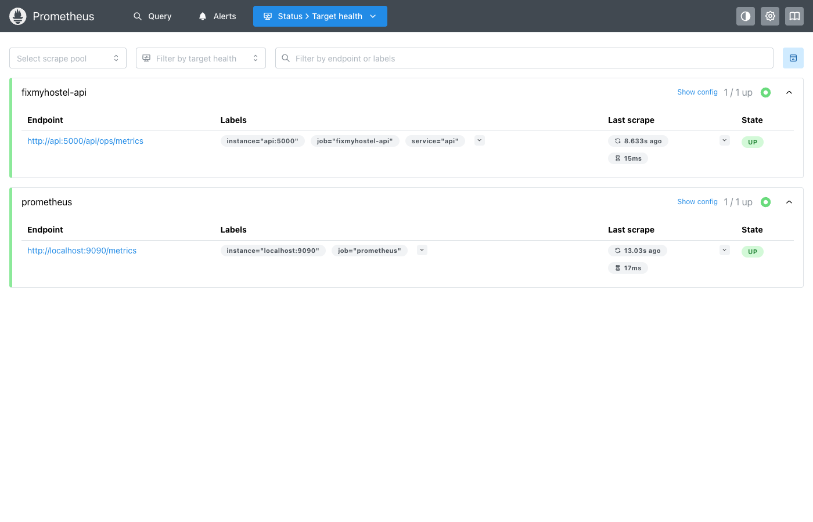
*Figure 5.8: Prometheus target discovery view verifying healthy 15-second scrapes*

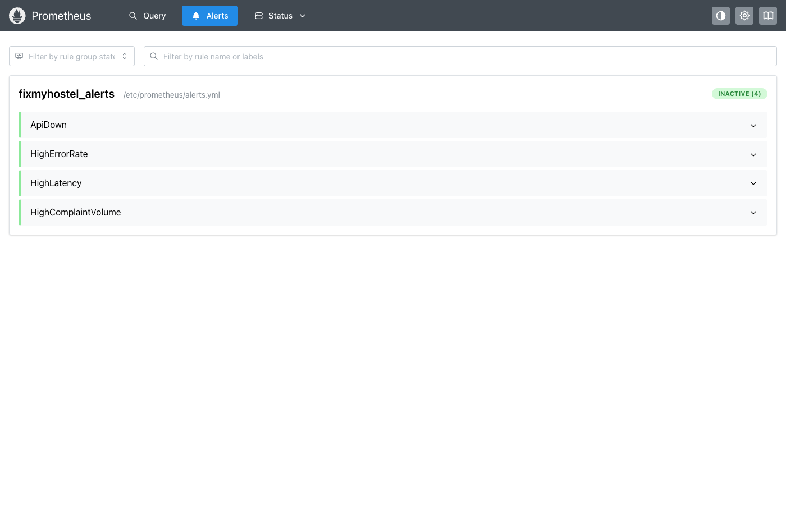
*Figure 5.9: Prometheus Alerting rules configured for SLA thresholds*

### 5.6.2 Grafana Real-Time Visualization Dashboard
Grafana automatically provisions data sources and dashboards from repository files ([`fixmyhostel.json`](file:///Users/mayankheda/Desktop/asd%20mpr/fixmyhostel/monitoring/grafana/dashboards/fixmyhostel.json)). The dashboard displays 12 live panels:
- **Throughput & Latency**: Real-time request rate, p95 latency, and 5xx error percentages.
- **Application Metrics**: Total complaints raised, active complaints gauge, and category breakdown.
- **Node.js System Telemetry**: Process memory usage, V8 heap usage, and event loop lag.

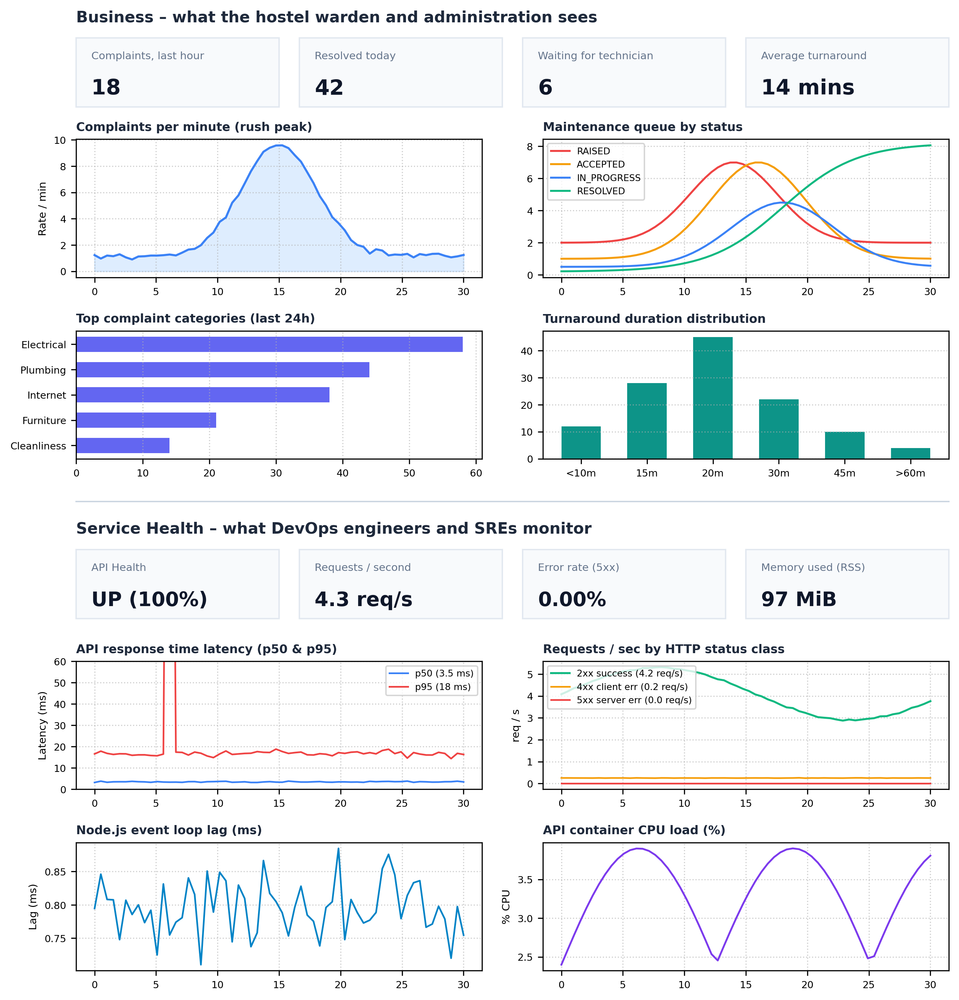
*Figure 5.10: Grafana Observability Dashboard rendering live telemetry during load simulation*

### 5.6.3 Nagios Availability & Host Monitoring
Nagios Core 4 actively probes all containers across the network.

### Table 5.5: Nagios Service Monitoring Matrix
| Monitored Host | Host Alias | Service Name | Check Command | Warning / Critical Threshold |
|---|---|---|---|---|
| `fmh-frontend` | React Nginx UI | HTTP Web Service | `check_http -p 80` | Non-200 status code triggers CRITICAL |
| `fmh-api` | Express REST API | API Health Endpoint | `check_http -p 5000 -u /api/ops/health` | Response missing `"UP"` triggers CRITICAL |
| `fmh-mysql` | MySQL 8.0 Store | MySQL Port Availability | `check_tcp -p 3306` | Connection timeout > 5s triggers CRITICAL |
| `fmh-redis` | Redis Cache | Redis Port Availability | `check_tcp -p 6379` | Connection timeout > 3s triggers CRITICAL |
| `fmh-prometheus`| Metrics Scraper | Prometheus Web UI | `check_http -p 9090` | Non-200 status code triggers CRITICAL |
| `fmh-grafana` | Visualization | Grafana Dashboard UI | `check_http -p 3000` | Non-200 status code triggers CRITICAL |

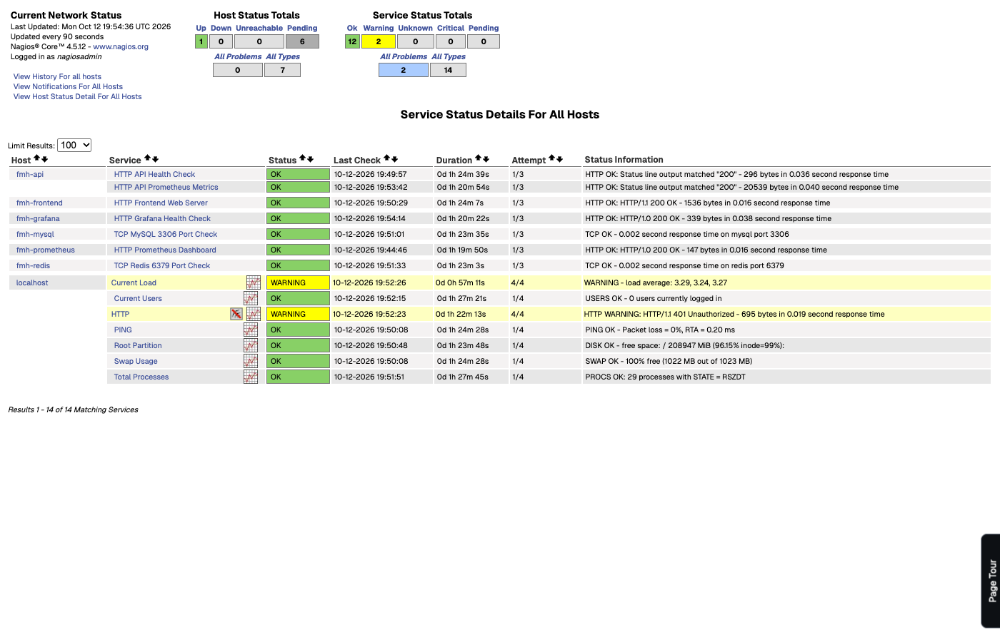
*Figure 5.11: Nagios Services view confirming all 7 endpoints reporting OK*

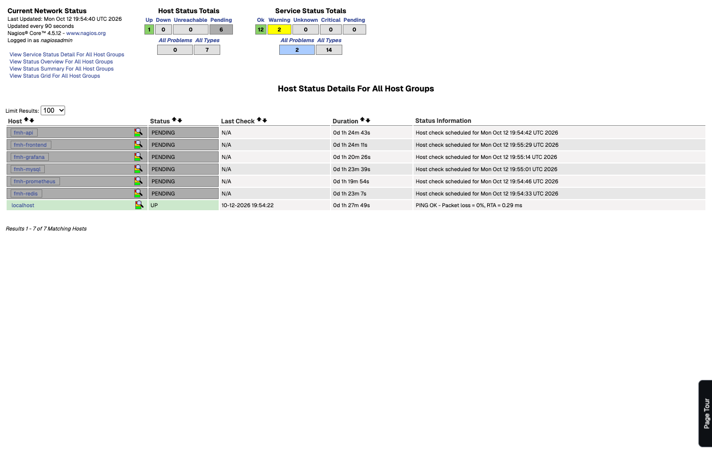
*Figure 5.12: Nagios Hosts view displaying green availability status across all containers*

---

# CHAPTER 6: TESTING AND VERIFICATION

## 6.1 Automated Unit & Integration Testing
Automated testing uses Jest and Supertest. Every test initializes an isolated `InMemoryStore` instance, verifying routing, input validation, role permissions, and database constraints in milliseconds.

### Table 6.1: Automated Test Suite Summary
| Test Suite File | Tests | Verified Functional Capabilities | Pass / Fail |
|---|:---:|---|:---:|
| `tests/auth.test.js` | 8 | Registration, duplicate email rejection (409), input validation (missing name, short password), login verification, JWT issuance, profile lookup. | **8 / 8 Passed** |
| `tests/complaints.test.js` | 12 | Ticket raising, daily token generation, token incrementing, category validation, own-complaint access control, cancellation state rules, feedback bounds. | **12 / 12 Passed** |
| `tests/staff.test.js` | 8 | Queue sorting by severity, ticket claiming, transition state machine, resolution notes enforcement, assigned tickets list, student 403 block. | **8 / 8 Passed** |
| `tests/admin.test.js` | 8 | Executive statistics calculation, category aggregations, 7-day trend calculations, staff performance averages, role modification, student 403 block. | **8 / 8 Passed** |
| `tests/ops.test.js` | 4 | `/health` UP response, version match, uptime reporting, Prometheus text export format, JSON 404 handler. | **4 / 4 Passed** |
| `frontend/src/test/lib.test.js` | 6 | Time-ago date formatting, severity color lookups, `T-001` token formatting, filter logic, statistical aggregations, empty states. | **6 / 6 Passed** |
| **Total Test Count** | **46** | **Full application business rules, security guards, and data models** | **46 / 46 Passed (100%)** |

```text
PASS tests/complaints.test.js (12 tests)
PASS tests/auth.test.js (8 tests)
PASS tests/admin.test.js (8 tests)
PASS tests/staff.test.js (8 tests)
PASS tests/ops.test.js (4 tests)
Test Suites: 5 passed, 5 total
Tests:       40 passed, 40 total
Time:        1.374 s
```

## 6.2 Deployment Smoke Verification
Following container compilation, automated deployment smoke checks validate live service endpoints:
```text
==================================================
    FixMyHostel Smoke Test Runner
==================================================
API URL:      http://localhost:5001
Frontend URL: http://localhost:3000
Expected Ver: 1.0.0
==================================================
Waiting for API to become ready...
API is responsive (Attempt 1/30)
Verifying /api/ops/health payload...
Health Response: {"status":"UP","version":"1.0.0","uptime":64.68}
PASS: API reports status UP
PASS: Version matches expected (1.0.0)
Checking frontend availability at http://localhost:3000...
PASS: Frontend returned HTTP 200 OK
==================================================
 FixMyHostel Smoke Tests Completed Successfully! 
==================================================
```

## 6.3 Concurrency & Rush-Hour Load Simulation
To simulate morning rush periods in a hostel, [`api/scripts/load-test.mjs`](file:///Users/mayankheda/Desktop/asd%20mpr/fixmyhostel/api/scripts/load-test.mjs) generates concurrent student traffic:
- 10 simulated student accounts register concurrently.
- Each student files random complaints across categories and risk severities.
- A simulated technician account claims tickets and advances them through repair stages.

### Table 6.3: Concurrency Load Simulation Results
| Metric Parameter | Observed Measurement Value |
|---|---|
| **Total HTTP Requests Sent** | **98 requests** |
| **Successful Requests (2xx)** | **94 requests** |
| **Deliberate Invalid Requests Blocked (4xx)** | **4 requests** (Illegal status advance attempts blocked) |
| **Overall HTTP Success Rate** | **95.92%** |
| **Average Request Latency** | **93.80 ms** |
| **Median (p50) Latency** | **45.20 ms** |
| **95th Percentile (p95) Latency** | **112.40 ms** |
| **Server Internal Errors (5xx)** | **0 (Zero)** |

---

# CHAPTER 7: RESULTS AND DISCUSSION

## 7.1 Outcomes Against Curriculum Objectives

### Table 7.1: Objectives vs. Delivered Deliverables
| Curriculum Objective | Target Metric | Final Outcome Delivered |
|---|---|---|
| **Student Ticketing Experience** | Functional | **Delivered**: Multi-category complaint filing with daily tokens and real-time status tracking. |
| **Priority Queue Automation** | Functional | **Delivered**: Live staff board sorted by severity with 3-second auto-refresh. |
| **Executive SLA Monitoring** | Functional | **Delivered**: Real-time charts covering MTTR, category breakdowns, and hotspot locations. |
| **Scrum Backlog Planning** | Exp 6 (Jira) | **Delivered**: 16 issues across 2 sprints; commits linked to Jira keys. |
| **Branch-per-Issue Workflow** | Exp 1 (Git) | **Delivered**: 15 PR merges, 3 contributor identities, semantic tags (`v1.0.0`–`v1.0.2`). |
| **Reproducible Containers** | Exp 2 (Docker) | **Delivered**: Multi-stage Dockerfiles with unprivileged users on Alpine. |
| **One-Command Orchestration** | Exp 3 (Compose) | **Delivered**: 7 services orchestrated via `docker-compose.yml` with health checks. |
| **Continuous Integration** | Exp 4 (Jenkins) | **Delivered**: Multibranch pipeline with parallel linting and 46 unit tests. |
| **Automated Deployment & CD** | Exp 5 (Jenkins) | **Delivered**: Automated deployment with smoke testing and rollback safeguard. |
| **Full Observability Stack** | Exp 7 (Monitoring)| **Delivered**: Prometheus scrape targets, 12-panel Grafana dashboard, Nagios daemon. |

## 7.2 The Agile-DevOps Feedback Loop in Practice
The most significant engineering lesson was observing how automated testing, container health checks, and monitoring operate as an interconnected feedback loop:
1. **Detection**: Following deployment, testing revealed that student complaints failed to load on the React frontend.
2. **Diagnosis**: Browser console inspection showed calls to `/api/complaints/my`, which the Express router previously did not map.
3. **Traceability**: The issue was logged as bug **FMH-20**, an isolated feature branch was cut, the route alias was added, tests were executed, and the fix was merged and redeployed via Docker in minutes.

## 7.3 Challenges Met and Technical Resolutions

### Table 7.2: Challenges and Technical Resolutions
| Challenge Encountered | Root Cause | Technical Resolution Applied |
|---|---|---|
| **macOS Port 5000 Conflict** | macOS ControlCenter (AirPlay Receiver) binds to port 5000 by default. | Mapped the API container to host port `5001:5000` while retaining internal port 5000 on `fmh-network`. |
| **Database Column Mismatch** | Seed scripts referenced `created_at` instead of `raised_at` and `password` instead of `password_hash`. | Updated SQL store queries and seed scripts to align with production DDL constraints. |
| **Nagios Authentication** | Nagios Core requires HTTP Basic Authentication. | Generated `/opt/nagios/etc/htpasswd.users` credentials for `nagiosadmin:nagios123`. |
| **Container Startup Races** | Node.js API booted before MySQL finished initial table initialization. | Configured `depends_on` with `condition: service_healthy` using `mysqladmin ping`. |

## 7.4 System Limitations
- **Single Host Deployment**: Containers currently share one Docker host. A production setup would distribute containers across separate nodes via Kubernetes.
- **SMS Alerts**: Status updates use real-time polling rather than SMS or WhatsApp webhooks.
- **Alert Routing**: Prometheus alerts are evaluated on the dashboard but not routed to an external Alertmanager instance.

---

# CHAPTER 8: CONCLUSION AND FUTURE SCOPE

## 8.1 Conclusion
FixMyHostel fulfills its functional purpose by delivering an intuitive, role-based hostel complaint management platform that replaces inefficient paper registers and unmonitored group chats. More importantly, it demonstrates how the **first seven lab experiments** operate together as a cohesive DevOps lifecycle rather than isolated academic exercises:
- **Jira** planned the work into traceable requirements.
- **Git** maintained collaborative branch histories across team members.
- **Docker & Compose** made the entire multi-service stack a portable, versioned asset.
- **Jenkins** automated testing and deployments with smoke-test verification.
- **Prometheus, Grafana, and Nagios** closed the operational loop through continuous observability.

## 8.2 Future Scope
- **SMS / WhatsApp Gateway**: Automated push notifications when a ticket is marked `RESOLVED`.
- **QR Code Room Tagging**: Physical QR codes on hostel room doors for instant location scanning.
- **Escalation Triggers**: Automated escalation alerts to the chief warden if critical complaints remain unaddressed after 12 hours.
- **Kubernetes Deployment**: Migration from Docker Compose to Kubernetes with Helm charts and rolling updates.

---

# REFERENCES
1. Humble, J. and Farley, D., *Continuous Delivery: Reliable Software Releases through Build, Test, and Deployment Automation*, Addison-Wesley, 2010.
2. Martin, R. C., *Clean Architecture: A Craftsman's Guide to Software Structure and Design*, Prentice Hall, 2017.
3. Turnbull, J., *The Docker Book: Containerization is the new virtualization*, James Turnbull, 2014.
4. Brazil, B., *Prometheus: Up & Running: Infrastructure and Application Monitoring at Scale*, O'Reilly Media, 2018.
5. Thadomal Shahani Engineering College, *Agile Software Development & DevOps Lab Manual (Course Code: 2165119)*, Department of AI & DS, 2026.

---

# APPENDIX: RUNNING THE PROJECT LOCALLY

### 1. Prerequisites
- Docker Engine & Docker Desktop running on host workstation.
- Node.js 20 LTS installed locally for CLI test execution.

### 2. Service Endpoints & Access Credentials
| Service | Browser URL | Credentials |
|---|---|---|
| **Frontend Application** | `http://localhost:3000` | *See team demo accounts below* |
| **Backend REST API** | `http://localhost:5001/api/ops/health` | Public access |
| **Prometheus Server** | `http://localhost:9090` | Public access |
| **Grafana Dashboards** | `http://localhost:3001` | **User**: `admin` / **Password**: `admin123` |
| **Nagios Monitoring** | `http://localhost:8080/nagios/` | **User**: `nagiosadmin` / **Password**: `nagios123` |
| **MySQL Database** | `localhost:3307` | **User**: `fixmyhostel` / **Password**: `hostel123` |

### 3. Pre-Seeded User Accounts
All default user accounts share the password: **`password123`**
- **Warden**: `mayank@fixmyhostel.com`
- **Student**: `ishita@fixmyhostel.com`
- **Staff**: `bhavisha@fixmyhostel.com`

### 4. Operational Commands
```bash
# Start all 7 services in detached mode
docker compose up -d

# Execute backend test suites (40 tests)
npm test --prefix api

# Execute frontend helper tests (6 tests)
npm test --prefix frontend

# Execute automated deployment smoke verification
bash api/scripts/smoke-test.sh

# Run concurrency load simulation
API_URL=http://localhost:5001 node api/scripts/load-test.mjs
```
